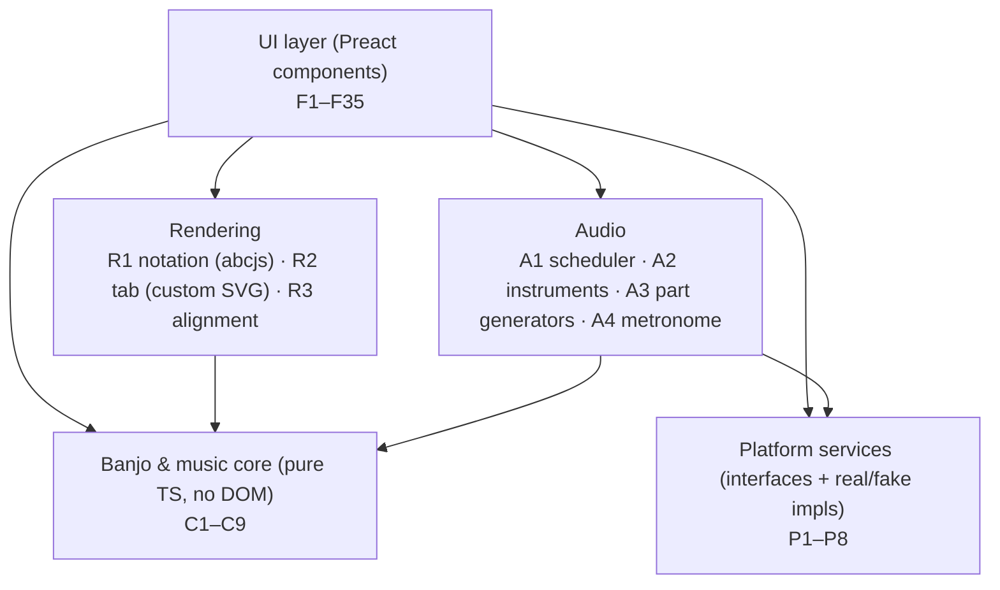
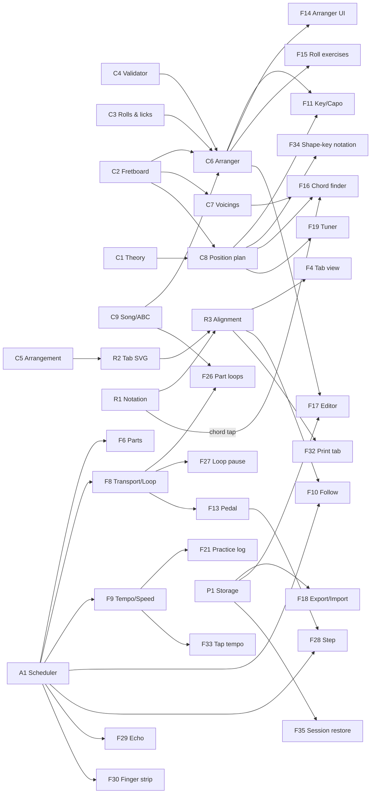

# Banjo Practice App: Development Specification

Nov 8, 2026 · Jeff (drafted with Claude) · **Rev 2**, after an independent review by Fable (changes summarized in §15)

This is the build reference. It merges [`PLAN.md`](PLAN.md) (what the app does) with [`BANJO_STYLE_GUIDE.md`](BANJO_STYLE_GUIDE.md) (how Scruggs banjo works) into one scoped set of modules, features, dependencies and phases. Testing for stability is specified separately in [`CHAOS_TESTING.md`](CHAOS_TESTING.md).

- When this file and `PLAN.md` disagree, this file wins (it records the decisions made since).
- For banjo rules, `BANJO_STYLE_GUIDE.md` wins, except for the corrections listed in §11.
- IDs (`C3`, `P2`, `F14`…) are stable. Use them in issues, commits and tests.

---

## 1. Goals and constraints

**Who it's for:** Dad, playing a 5-string Deering banjo, three-finger Scruggs style in open G. **He reads mainly tab**, but the app always shows proper standard notation as well.

**What it does:** pick a song, see it as notation with chords plus a Scruggs banjo tab, hear it at any tempo and key, and play along.

**Hard constraints:**

| Constraint | Consequence |
| --- | --- |
| Built on Windows, no Mac or App Store | PWA installed from Safari with Add to Home Screen |
| HTTPS required (microphone, service worker) | GitHub Pages |
| Must work with no Wi-Fi after the first load | Service worker caches the app, songs and all sounds |
| No server | All data on the iPad, with export/import as backup |
| **Stable**: Dad is not going to debug it | Platform APIs behind interfaces, fault-tolerant storage, session restore after iPadOS reloads the app, chaos testing ([`CHAOS_TESTING.md`](CHAOS_TESTING.md)), a diagnostics screen Jeff can read remotely |
| Built-in content must be original | All ABC and tab written fresh; public-domain tunes only (§10) |

**Not in scope** (from the style guide §12): clawhammer, melodic (Keith) style, single-string (Reno) style, and tunings other than open G for arranging (tunings are data, so more can come later).

---

## 2. Architecture

A single-page TypeScript app with no backend. The layers depend downward only.



Principles:

1. **The core is pure.** `C*` modules have no DOM, audio or storage access. That makes them fully unit- and property-testable, and they hold most of the banjo knowledge. abcjs's parser is used in the core only through a thin adapter that returns plain data.
2. **Every platform API sits behind an interface** (`P*`). Each has a real implementation and a fake one. The fakes power unit tests, and the **chaos layer** wraps the real ones to inject faults ([`CHAOS_TESTING.md`](CHAOS_TESTING.md) §3). Fakes must model **observed iPad behavior** (e.g. `resume()` rejecting until the next tap), not ideal behavior.
3. **One practice context.** Key, capo, 5th-string raise, tuning, tempo and enabled parts live in a single store (`PracticeContext`, §2.2). Notation, tab, playback, chord finder and tuner all read from it, so they can never disagree.
4. **One audio clock.** Melody, chords, banjo and metronome are all scheduled on one Web Audio clock (§6.1).
5. **Assume the page can vanish at any moment.** iPadOS discards backgrounded Home Screen apps and reloads them from scratch, so anything Dad would expect to "still be there" is persisted as it changes (§5.2).

### 2.1 Stack

| Concern | Choice | Why |
| --- | --- | --- |
| Language | TypeScript (strict) | The style guide's data model is already TS; types catch music-model mistakes |
| Build | Vite | Fast, simple static output for Pages |
| UI | Preact + @preact/signals | Small (~4 KB), React-like; signals suit the shared practice context |
| Notation | abcjs | Notation, chord symbols, ABC parsing, **note-event expansion** (repeats, endings, ties, triplets) and timing data |
| Tab | Custom SVG renderer (R2) | Colored finger badges, bold melody, slur labels and roll names go beyond abcjs tablature |
| Audio | Own Web Audio scheduler (A1) playing per-note mp3 samples in the midi-js-soundfonts format | abcjs's synth renders a whole tune into one buffer at a fixed tempo, so live tempo, live mute and seamless loops would all need re-rendering. Confirmed by review; spike S1 checks sound quality and whether the `smplr` sampler can do the voice management |
| Storage | IndexedDB via `idb`, plus `localStorage` for tiny crash-safe state | Durable, larger than localStorage |
| Offline | vite-plugin-pwa (Workbox) | Precaching; new versions apply on next cold launch |
| Tuner pitch detection | `pitchy` (McLeod method) or own YIN | Small, accurate down to D3 (147 Hz) |
| Tab printing | svg2pdf.js + jsPDF | Tab → PDF without `window.print()` (unreliable in Home Screen apps) |
| Unit and property tests | Vitest + fast-check | Property tests suit the validator and arranger |
| End-to-end and chaos tests | Playwright (Chromium; **WebKit if phase 0 confirms Web Audio works there on Windows**) | WebKit is the closest stand-in for iPad Safari available on Windows |
| CI/deploy | GitHub Actions → GitHub Pages | Test gate before every deploy |

All dependencies are pinned to exact versions in `package.json` with a committed lockfile. Full table in §12.

### 2.2 Shared state

```ts
interface PracticeContext {
  songId: string | null;
  soundingKey: Key;            // { tonic: "A", mode: "mixolydian" }; what the audio sounds
  notationKey: "sounding" | "shape";  // F34: show notation in the sounding key or in the tab's shape key
  position: PositionPlan;      // from C8: shape key, capo fret, 5th-string raise, instruction text
  tuning: Tuning;              // open G for now
  tempoBpm: number;            // beats per minute, beat as notated in the song (Q: field); see C9
  parts: { melody: PartState; chords: PartState; banjo: PartState; metronome: MetronomeState };
  loop: { kind: "song" } | { kind: "part"; part: string } | { kind: "section"; fromMeasure: number; toMeasure: number } | null;
  loopGapBeats: 0 | 1 | 2 | 4; // F27: pause between loop repeats
  practiceMode: "normal" | "echo" | "step";   // F28, F29
  speedBuilder: { enabled: boolean; startBpm: number; stepBpm: number; targetBpm: number } | null;
  transport: "stopped" | "count-in" | "playing" | "paused";
}
```

Settings (F20) are a separate persisted store. Everything in `PracticeContext` except `transport` is persisted per song as it changes (debounced, §5.2), so an iPadOS reload brings Dad back to the same song, place, key, tempo and loop.

---

## 3. Banjo and music core (pure modules)

This is where the style guide becomes code. Each module lists its source section in the guide.

### C1. Music theory primitives

- Pitches (MIDI number plus spelling), intervals, key signatures, and **modes**: major, minor, Dorian and Mixolydian (needed for Shady Grove, Cluck Old Hen and Old Joe Clark). The mode comes from the ABC `K:` field (`K:AMix`, `K:EDor`).
- Chord symbol parse and format: root, quality (major, minor, 7, m7, maj7, dim, aug, sus4, 6, 9 at minimum), optional slash bass.
- **Conventional spelling**: spell by key signature and chord root, flats in flat keys (B♭ not A♯). Unit tests cover all 12 tonics × 4 modes.
- **C1 is the single source of truth for transposition.** The app transposes the ABC *text* itself and hands abcjs pre-transposed ABC, so the spelling Dad sees is the spelling C1 tested. (abcjs's own transposition is not used.)

### C2. Tuning and fretboard model (guide §1.1, §1.2)

- `Tuning` as data: `openMidi` for strings 1–5. Open G = `[62, 59, 55, 50, 67]`.
- **Tab fret numbers are stored capo-relative** (a number counts frets above the capo, and `0` on the 5th string means "open at its spike or retuned pitch"), so one formula covers every capo and the stored tab never changes when the capo moves.
- **Displayed as actual frets by default** (decided Nov 8, 2026: Dad's books number actual frets). Settings offer a "number from the capo" toggle. With no capo the two are identical, so this only matters for capoed songs.
- **The capo is a first-tier control**, not a buried setting: a capo picker sits next to the key picker in the toolbar (F11), and the tab header always shows the current capo and 5th-string instruction.
- `pitchAt(string, fret, plan)`:
  - Strings 1–4: open + capo + fret.
  - 5th string: open + raise + (fret − 5 if fretted, else 0). Fretted 5th-string numbers are ≥ 6. With capo-relative numbers this one formula holds for both a spike and a retune.
  - Actual fret for display: strings 1–4 = fret + capo. 5th string = fret + raise when spiked, or fret when retuned.
- `positionsFor(midi, plan)`: every (string, fret) that produces a pitch, frets 0–22 (actual).
- 5th-string plan: `fifthRaise: { semitones, by: "spike" | "retune", spikeFret? }`. `fifthStringPlan(capo, spikes)` uses a spike at fret `5 + capo` if Dad has one, otherwise "tune the 5th string up to X". **Spikes are a setting, default none** (Dad's Deering Goodtime Artisan isn't confirmed to have any; "tune up" always works, a missing spike doesn't). A "Deering 7, 9, 10" preset is one tap.

### C3. Roll library (guide §5)

- The 8 named rolls as **finger templates**, each with example string patterns for G, accent slots and a "typical use" tag for the arranger.
- Half-rolls: any 4-slot half of one roll joined to a half of another, allowed only if the join passes C4.
- **Lick templates** (rule-built, written fresh): e.g. slide 3rd string 2→3 into an open-2nd melody note, hammer 3:0→3:2 at a C→G change, 2nd-string pull-off under D7, thumb–pinch fills, and tag-ending shapes. These are first-class arranger candidates alongside rolls (§11 item 12).
- A **slot** is one roll note: 8 per measure whether the tune is written in 4/4 with eighths or in 2/4 with sixteenths (guide §2). See C9 `rollUnit`.
- The library is data, validated at test time by C4.

### C4. Rule validator (guide §4.1)

`validate(measures, tuning, plan, playbackOrder) => Violation[]`, a pure function. Each violation has a rule ID, measure, slot and a human-readable message. "Picked neighbors" means consecutive **single picked notes**. Slurs, holds and rests are skipped over, and pinches follow their own rule (H9).

| Rule | Check |
| --- | --- |
| H1 | No finger picks two single notes in a row, across bar lines and half-roll joins in written order |
| H2 | No two consecutive single picks on the same string. **Provisional hard rule**: if the phase-1 hand-written tunes need idiomatic exceptions (e.g. I then T on the 2nd string), it becomes a scored preference (§11 item 11) |
| H3 | Fingers don't cross. Ranking T > I > M: in a pinch, string(T) > string(I) > string(M); for consecutive picks, the higher-ranked finger is on a string number ≥ the lower-ranked finger's |
| H4 | Finger–string pairs only from the "usual" and "occasionally" columns (guide §3) |
| H5 | Left-hand reach: fretted notes within one shape span ≤ 4 frets, ≤ 4 fretting fingers. The 5th string is fretted only inside tagged licks |
| H6 | **Every slot is covered** by a note that starts there or is still sounding (held pinch, held note). Silent slots (rests) only in tag endings and at the end of a phrase or piece |
| H7 | A slur (`h`, `p`, `/`, `\`, `ch`) has no finger, stays on the string of the note before it, and moves the right way (hammer up, pull down) |
| H8 | Every note is playable in the tuning (fret range; 5th string open or fretted ≥ 6) |
| H9 | **Pinches**: no pinch may contain the finger that picked the single note directly before it, *except the thumb on a strong beat* (slots 1, 3, 5, 7), where a pinch acts as a hand reset. The single note after a pinch is not restricted by H1 (the hand resets on the pinch). Thumb–pinch patterns and tag pinches are legal |

**Joins:**
- Within the written order, joins are hard rules.
- **Repeat back-edges and first/second-ending jumps** are checked but reported as *warnings*. The arranger scores them (C6), since one measure can have several possible next measures.
- **Section-loop restarts are exempt**, because Dad chooses the loop points at run time. The loop pause (F27) covers the hand reset.

Scored preferences (guide §4.2) live in C6, not here.

### C5. Arrangement model and tab text format (guide §11)

```ts
type Finger = "T" | "I" | "M";
type Technique = "pick" | "hammer" | "pull" | "slide-up" | "slide-down" | "choke";

interface TabNote {
  slot: number;            // 0-based in code
  durationSlots: number;   // 1 = eighth (one roll note); 2 = quarter, etc. Needed for pinch fills, tags, stems
  string: 1 | 2 | 3 | 4 | 5;
  fret: number;            // capo-relative (C2)
  finger: Finger | null;   // null iff technique !== "pick"
  technique: Technique;
  isMelody: boolean;
  isAccent: boolean;
  pinchGroup?: number;
}

interface ArrangedMeasure {
  index: number;           // written measure number; 0 = pickup
  slots: number;           // 8 for a full measure; fewer for a pickup
  chords: { atSlot: number; chord: string }[];
  rollName: string;        // "forward", "alternating-thumb", "forward+backward", "tag", "lick:<id>"
  source: "hand" | "generated" | "override";
  notes: TabNote[];
}

interface Arrangement {
  schemaVersion: number;
  shapeKey: Key;           // the key the tab shapes are in
  fifthStringDefault?: string;   // per-song choice, e.g. "b" for key of E (§11 item 2)
  measures: ArrangedMeasure[];
}
```

**Tab text format** (for hand-writing built-in songs and readable diffs). One line per measure, **exactly one token per slot**. Slot and chord positions in the text are **1-based** (as in the UI); the parser converts to 0-based.

```
m1  G          forward          | 3:0T* 2:0I 1:0M 5:0T> 2:0I 1:0M* 5:0T> 1:0M |
m2  C@1 G@5    alt-thumb        | 4:2T 2:1I* 5:0T 1:2M 3:0T 2:0I* 5:0T 1:0M |
m3  G          lick:slide-3     | 3:2T /3:3 2:0I* 1:0M 5:0T 2:0I 1:0M - |
m4  G          tag              | 3:0T 2:0I [5:0T,1:0M] - 3:0T . [5:0T,1:0M] - |
```

- `s:fF` = string, fret, finger. A trailing `*` marks melody and `>` an accent (forward-roll accents are filled in by default).
- A `h` / `p` / `/` / `\` / `ch` prefix marks a slurred note (no finger).
- `[ … ]` is a pinch. `-` holds the previous note or pinch through this slot. `.` is a silent slot (allowed only where H6 allows).
- The four example lines, read as one 4-measure piece, pass C4 (they're used as fixtures): m2 is the exact alternating-thumb template (T I T M T I T M), m3 is the idiomatic 3rd-string slide (A → B♭) resolving to the open 2nd string, and m4 is a tag.
- Parser and serializer round-trip exactly (property-tested). Malformed input gives line and column errors and never throws uncaught.

### C6. Arranger (guide §7)

Input: melody notes and chords per measure (from C9), plus shape key, tuning and plan. Output: an `Arrangement` that passes C4's hard rules, or explicit "can't place" diagnostics per measure. It never silently returns an illegal arrangement.

1. **Simplify the melody to slots**: keep strong-beat and long notes, drop or slur passing notes shorter than a slot, and record what was dropped so the editor can show it.
2. **Locate** each kept melody note with `C2.positionsFor`, filtered to strings 1–3 (string 4 allowed for thumb lead) and the current chord shape.
3. **Candidates** per measure (capped at ~100): roll templates, half-roll pairs and **lick templates** (C3) that put an allowed finger on the melody string at the melody slot. Melody arriving by hammer-on or slide is a candidate too.
4. **Fill** the other slots with chord tones on allowed strings plus the open 5th-string drone.
5. **Validate** with C4; hard-rule failures are rejected.
6. **Score** the soft preferences (guide §4.2): named roll, melody on accent slots, strings 1–3, first position, chord-tone fillers, continuity, small left-hand motion, plus a **bonus for idiomatic licks** at chord changes and phrase ends. Weights are a config object, tuned against the hand-written built-ins with **leave-one-out** checks so they generalize beyond 4 tunes.
7. **Exact search (Viterbi dynamic programming)** across measures in written order. State = last finger, last string, hand position, roll. That's at most a few hundred states, about 300k evaluations for 64 measures: deterministic, and well inside budget. Then **score repeat back-edges** and locally repair the measures at the join if needed.
8. **Phrase endings and tags**: long held melody notes get a thumb–pinch fill or a fill lick. The last measure gets a tag ending on a pinch.
9. **Explainability**: every measure records `rollName` and `source`. Overrides (F17) pin a roll for a measure or half-measure, and the search re-runs around it.

Performance: a 32-measure tune arranges in under 300 ms on the iPad. The arranger runs in a Web Worker with a hard 2 s timeout that returns the best legal result so far. In the editor it re-runs on each change with a "rearranging…" indicator; partial songs are fine.

### C7. Chord voicing generator (guide §8)

- Computes voicings for any chord C1 can parse: every combination of strings 1–4 (frets 0–17) whose pitch classes are chord tones.
- **Required tones**: triads need root and third. 7th chords need root and 7th, and the third may be omitted, labeled "no 3rd" (the guide's D7 `0 2 1 0` has no F♯ and must be found). The fifth is always optional.
- Reach (H5), ≤ 4 fretting fingers, open strings free.
- 5th string: shown as "open drone", flagged *in chord* or *adds color*.
- Ranking: open/first position first, then up the neck. Named shapes (barre, F, D, minor variants) are labeled.
- **Test oracle**: it must find every shape in guide §8.1 and §8.2.
- Capo-aware, with the C2 "actual frets" toggle.

### C8. Key, capo and position planner (guide §9)

Given a sounding key (tonic + mode), the arrangement's shape key and Dad's spikes, C8 returns a `PositionPlan`.

**When the key isn't changed**, the plan uses the arrangement's own shape key: a tune arranged in C position plays in C position, uncapoed.

**When Dad changes the key**, plans are keyed on the **key signature** (the pitch collection), not just the tonic, through a per-mode table:

| Sounding key | Shapes | Capo |
| --- | --- | --- |
| G major / G Mixolydian | G | 0 |
| A major / A Mixolydian | G | 2 |
| B♭ major | G | 3 (5th: retune to b♭) |
| B major | G | 4 |
| C major | C position | 0 (or G shapes capo 5, offered as an alternative) |
| D major / D Mixolydian | D position | 0 (5th to a, or left at g) |
| E major | D position | 2 (5th to b by default, a as option; §11 item 2) |
| F major | C position | 5 |
| E♭ major | D position | 1 |
| A Dorian | G-major pitch set: Am/G/D shapes | 0 |
| B Dorian | as A Dorian | 2 |
| E minor | Em/C/D/G shapes | 0 |
| A minor | Am/G/F/E shapes | 0 (or Gm shapes capo 2) |

- **Practical capo limit is fret 5.** Plans needing capo 6–7 offer the alternative position instead; above 7 is never offered.
- The table is completed for all 12 tonics × 4 modes and tested exhaustively.
- **Tab stays or is re-arranged**: if the new plan uses the same shape family, the tab is unchanged and only the capo instruction appears. Otherwise C6 re-arranges, and a hand-written arrangement shows the notice "This key uses an auto-generated arrangement."
- Instruction text, e.g. "Capo 2 · 5th string to A (spike at 7)" or "Capo 3 · tune 5th string up to B♭".

### C9. Song model and ABC handling

- A song is its ABC text (melody, chord symbols, meter, `Q:` tempo, key with mode, repeats, endings, optional `P:` parts) plus an optional `Arrangement`, plus metadata (title, source `builtin`/`user`, tags, credits, `schemaVersion`).
- **`rollUnit`**: the note value of one slot, 1/8 for 4/4 and cut time, 1/16 for 2/4 fiddle-style notation. It's derived from `M:`/`L:` and can be overridden in metadata. Slots per measure = measure length ÷ `rollUnit` (normally 8).
- **Tempo**: `tempoBpm` is in the beat as notated (from `Q:`), so the BPM Dad sees matches the printed music. The scheduler works internally in roll notes per minute.
- **Event expansion comes from abcjs**: melody and chord note events, with repeats, endings, ties, triplets, grace notes and broken rhythms expanded, plus timing data. C9 does not re-implement ABC playback semantics.
- **C9 builds the measure index**: written measure numbers (pickup = 0), chords per slot, melody per measure, the repeat structure, **parts** (A/B from repeat structure or `P:`), and the **playback order map**, built from abcjs's expansion and used by highlight, loops and C4 joins.
- **Meters**: 4/4, 2/2 and 2/4 are fully supported. 3/4 renders and plays melody and chords, but the arranger is off for 3/4 in v1.
- Consistency check: same measure count and chords in melody and arrangement. On a mismatch the arrangement is flagged stale and regeneration is offered.

---

## 4. Rendering

### R1. Notation (abcjs)

- Melody staff with chord symbols above, from the C1-transposed ABC, in the sounding key or the shape key (F34).
- **Chord symbols are tappable** → open F16 with that chord and the current capo.
- Responsive line breaks to the screen width, re-rendered on rotate or resize (debounced).

### R2. Tab staff (custom SVG)

Conventions from guide §10:

- 5 lines, **top line = string 1**, bottom line = 5th string. Never flipped.
- Fret numbers on the lines. **Melody notes in bold**.
- Rhythm stems and beams below the tab **from `durationSlots`**: eighths beamed in 4s, quarter stems for held pinches, rests in tags.
- **Finger badges**: each picked note has a small colored badge under it with its letter (T / I / M), so the letter's contrast never depends on the color. Defaults are Okabe–Ito colors chosen for color-blindness, each paired with the letter color that gives the best contrast:

  | Finger | Badge | Letter | Contrast |
  | --- | --- | --- | --- |
  | T | `#E69F00` orange | black | ~9:1 |
  | I | `#0072B2` blue | white | ~5:1 |
  | M | `#CC79A7` reddish purple | black | ~7:1 |

  Colors are changeable in F20 with an automatic contrast check. Slurred notes have no badge.
- Slur arcs with `h`, `p`, `sl` / `/` / `\` or `ch` labels above. Pinches stacked in one slot.
- **Roll name label** above each measure (toggleable).
- Optional accent marks (`>`, off by default).
- Current-measure highlight light yellow (`#FFF3B0` or similar, never blue). Loop and part brackets drawn on both staves.

### R3. Alignment

- Tab measures line up under the notation's measures: same widths, same line breaks.
- abcjs spaces measures by how many notes they hold, so a measure with one long note would be too narrow for 8 tab slots. **Approach to test in spike S2**: add a hidden voice of 8 invisible rests (`x`) per measure to the layout ABC. abcjs then spaces every measure for 8 events, and its timing data gives the x-position of every slot. Fallback: read measure positions and widen narrow measures with a minimum width.
- **Tab-only view** (F22) lays the tab out with its own line breaks.
- The display size control scales both together.

---

## 5. Platform services

Every service has a **real**, a **fake** and a **chaos** wrapper implementation (§2 principle 2).

| ID | Service | Real implementation and iPad specifics | Failure modes it must handle |
| --- | --- | --- | --- |
| P1 | Storage | IndexedDB (`idb`). **Open with a timeout and retry** (Safari occasionally hangs or throws `UnknownError` on the first open). **Never `await` non-IDB work inside a transaction** (Safari auto-commits it): validate and migrate before opening one. `navigator.storage.persist()` requested but treated as advisory. Database name includes the base path (`banjo@/` vs `banjo@/staging/`) | Quota exceeded, unavailable or blocked, a newer DB version than this build, data cleared by Safari (which also clears the offline cache), corrupt records |
| P2 | Audio context | One `AudioContext`, unlocked on first tap. `navigator.audioSession.type = "playback"` where supported so the **silent switch doesn't mute the app** (spike S3). **Master limiter** (`DynamicsCompressorNode`) to prevent clipping. **On a route or session change** (Bluetooth, phone call, mic opened), compare `sampleRate` with the hardware rate and **recreate the context** if they differ (Safari otherwise plays distorted or off-pitch), always `close()`-ing the old one. Never more than one live context. The `interrupted` state (Safari-only) usually needs a user tap to resume | Suspended, interrupted, sample-rate change, output device change, creation failure |
| P3 | Sample loader | Per-note **mp3** samples (Safari has no Ogg) → decoded `AudioBuffer`, cached by the service worker. Buffers can be dropped and reloaded transparently | Offline before first cache, partial download, decode failure, slow network, buffers discarded by iOS |
| P4 | Offline / update | Workbox precache. **New versions activate on the next cold launch**, with no banner. Settings has "Check for update" and shows the version. A failed precache install leaves the old version serving. Kill switch: a versioned `sw-reset` path. Service-worker scope is the base path, so staging and production never overlap | Update mid-practice (silent until next launch), cache eviction, broken service worker |
| P5 | Wake lock | Screen Wake Lock API, re-acquired on `visibilitychange` | Unsupported or rejected (fallback: silent looping video, or a notice) |
| P6 | Input | Keyboard events from a Bluetooth page-turner pedal (PageDown, ArrowRight, Space…), always `preventDefault`ed so they don't scroll the page | Key repeat storms, unknown keys, pedal disconnect. **A paired pedal is a hardware keyboard, so iPadOS hides the on-screen keyboard**: text fields (search, song titles) show a hint "Pedal connected: turn it off to type" |
| P7 | Microphone | `getUserMedia` with `echoCancellation`, `noiseSuppression` and `autoGainControl` **off** (they mangle a banjo's attack). Opening the mic triggers the P2 sample-rate check | Permission denied or revoked, no device, interrupted by a call |
| P8 | Clock | `AudioContext.currentTime` for audio; `performance.now()` + rAF for UI. Latency compensation uses `outputLatency`, falling back to `baseLatency` or a measured value | Background throttling, time jumps on resume, rAF at 30 fps in Low Power Mode |

### 5.1 Home Screen PWA plumbing

- Vite `base`, manifest `start_url` and `scope`, and service-worker scope all use the repo subpath (`/<repo>/`).
- `apple-touch-icon` link tags (Safari uses these, not manifest icons, for the Home Screen icon).
- `viewport-fit=cover` and `env(safe-area-inset-*)` padding so the fixed toolbar clears the status bar.
- There's no URL bar in standalone mode, so every recovery path is a button (Reload calls `location.reload()`).
- **The Home Screen app has its own storage and permissions, separate from Safari.** Songs entered while testing in Safari won't appear in the installed app, and mic permission is asked again. Jeff's testing notes must say which one was used.

### 5.2 Session restore and crash-safe state

- **Session state** (last song, scroll position, loop, key, tempo, practice mode, editor draft pointer) is written on change (debounced 500 ms) and on `pagehide` (`beforeunload` doesn't fire on iOS). On launch the app reopens where Dad was, stopped.
- Per-song preference writes are debounced, so tempo slider drags don't cause hundreds of writes.

### 5.3 Diagnostics

- An in-memory ring buffer (last 200 entries: time, app version, message, stack, context), **mirrored to `localStorage`** (small, survives an IndexedDB failure) and copied to IndexedDB when it's healthy.
- Settings → *Diagnostics* shows it, with **"Share diagnostics"** (iPad share sheet).
- A UI crash shows "Something went wrong · Reload", never a blank screen. App version is shown in Settings and stamped into every diagnostic and export.

---

## 6. Audio

### A1. Scheduler (one clock)

- A look-ahead scheduler (~100 ms window, 25 ms tick) on `AudioContext` time, scheduling sample playback for every part.
- **Live changes without stopping**: tempo (from the next beat), part mute and unmute, instrument, volume.
- Seamless looping across the loop point, with the optional **loop pause** (F27) inserted between repeats.
- **Echo mode** (F29) and **step mode** (F28) are schedule transforms: echo silences alternate phrases, step schedules one slot per tap.
- Emits position events (measure, slot, beat), latency-compensated (P8), for F10 and F30.
- After Stop, all sources stop within 50 ms (no stuck notes).
- Pitch never changes with tempo.

### A2. Instruments

GM program numbers below are **0-based**. In code, instruments are referenced by midi-js-soundfonts **names** to avoid numbering mistakes.

| Part | Sound | Source |
| --- | --- | --- |
| Banjo | `banjo` (GM 105) | Soundfont (FluidR3_GM or MusyngKite, license checked in S4) |
| Chords | `acoustic_guitar_steel` (GM 25) | Soundfont |
| Melody | Choice: `violin` (GM 40, for fiddle; the GM "fiddle" patch 110 usually sounds worse), `flute` (GM 73), mandolin | Mandolin is **not in GM**: a bundled, license-clean sample set |
| Metronome | Click (accented downbeat) | Generated, no download |

Only instruments in use are loaded, and each is cached after first use (~1–3 MB each for the needed range).

### A3. Part generators (from C9, C6 and C8)

- **Melody**: abcjs note events, transposed by C1.
- **Chords, bluegrass boom-chuck**: bass note on beats 1 and 3 (alternating root and fifth), strum on 2 and 4. Half-measure changes follow `chords[].atSlot`.
- **Banjo**: every `TabNote` → pitch via `C2.pitchAt`, with its `durationSlots`. Pinches sound together. Slurred notes get a softer attack. Velocity: melody notes loudest, and accent slots get a smaller boost on top (§11 item 8). Straight eighths, no swing.
- Generators are pure functions (events in, events out), unit-testable without audio.

### A4. Metronome and count-in

- Modes: off, count-in only, or throughout. Count-in of 4 or 8 with **large on-screen numbers**.
- Click on every beat, or beats 2 and 4 only (the bluegrass "snare" feel).
- The visual metronome (F31) shares this timing.

---

## 7. Features

"Dep" lists the IDs a feature can't be built without.

| ID | Feature | Dep | Phase |
| --- | --- | --- | --- |
| F1 | App shell | P1, P4, §5.1 | 1 |
| F2 | Song library | C9, P1 | 1 |
| F3 | Notation view | R1, C9 | 1 |
| F4 | Tab view | R2, R3, C5 | 1 |
| F5 | Built-in songs (initial set) | C5, C9, C4 | 1 |
| F6 | Playback parts and mixer | A1–A3, P2, P3 | 2 |
| F7 | Metronome and count-in | A4 | 2 |
| F8 | Transport, auto-repeat, section loop | A1, C9 | 2 |
| F9 | Tempo and speed builder | A1 | 2 |
| F10 | Follow (highlight + auto-scroll) | A1, R1–R3 | 2 |
| F11 | Key change and capo instruction | C1, C8, C6 (shape changes) | 2 (same shape family) / 3 (re-arranging) |
| F12 | Keep screen awake | P5 | 2 |
| F13 | Pedal control | P6, F8 | 2 |
| F14 | Auto-arranger in UI | C6 | 3 |
| F15 | Roll exercises | C3, C4, C6, F6 | 3 |
| F16 | Chord finder and fretboard | C7, C2, C8, A2 | 4 |
| F17 | Song editor | C9, C6, C5, F6 | 5 |
| F18 | Export / import | P1, C9 | 5 |
| F19 | Tuner | P7, C2, C8 | 6 |
| F20 | Settings | P1 | 1 (grows each phase) |
| F21 | Practice log | P1, F9 | 6 |
| F22 | Display options | R1–R3 | 1 |
| F23 | Recording | P7, A1 | 6 |
| F24 | Favorites and recently played | F2, P1 | 1 |
| F25 | Diagnostics | §5.3 | 1 |
| F26 | Part loops (A part / B part) | C9 parts, F8 | 2b |
| F27 | Loop pause | A1, F8 | 2b |
| F28 | Step mode | A1, R2, F13 | 2b |
| F29 | Echo mode (call and response) | A1, C9 | 2b |
| F30 | Finger strip | A1, C5 | 2b |
| F31 | Visual metronome | A4 | 2b |
| F32 | Printable tab | R2, R3 | 3 |
| F33 | Tap tempo and tempo presets | F9 | 2b |
| F34 | Notation in shape key toggle | C1, C8, R1 | 2b |
| F35 | Session restore | §5.2 | 1 |

### Feature dependency graph



### Feature details

**F1 App shell**
- Toolbar always visible at the top (clear of the status bar): Play/Stop, Restart, Auto-repeat, tempo, key, part toggles, metronome.
- Collapsible left song panel. Landscape and portrait layouts.
- Tap targets ≥ 44 pt. Light theme. Dark mode is a later option, with finger-badge contrast re-checked.

**F2 Song library**
- Favorites and Recently played at the top, then Built-in, then My songs.
- Search box once there are more than 15 songs (see the P6 pedal/keyboard hint).
- Each row shows title, key, meter and a tag.
- Header shows **"Last backup: N days ago"** once he has his own songs.

**F3 Notation view.** R1 with tappable chords. The header shows the sounding key and the capo instruction.

**F4 Tab view.** Everything in R2 and R3.
- Because Dad reads tab mainly, the tab is visually primary: larger than the notation by default, with notation still shown above it.
- Tab-only is one tap away. Roll names are shown by default.
- Default view is a setting (both / tab-only), defaulting to both.

**F5 Built-in songs (phase 1)**
- 4 tunes, ABC and tab both **hand-written fresh**. Every tab passes C4 in CI, and Jeff and Dad review them musically.
- **Confirmed set** (Nov 8, 2026): Cripple Creek (Dad's favorite, written first), Old Joe Clark, Wildwood Flower (C position), Will the Circle Be Unbroken (1907 hymn).
- While writing them, count any H2 exceptions the music needs (§11 item 11).

**F6 Playback parts and mixer**
- Each part has on/off, volume and (melody) instrument. Parts change live while playing.
- **Play along** preset: banjo off, melody and chords on. **Listen** preset: everything on.

**F7 Metronome and count-in.** As A4. A count-in at each repeat when the speed builder raises the tempo (option).

**F8 Transport and looping**
- Play, Stop, Restart, Auto-repeat.
- Section loop *a*–*b*: tap the first and last measure on either staff, or pick from a dropdown. Brackets show it on both staves.
- Section loops play written measures *a*…*b* in order and ignore repeat signs inside. Whole-song play follows the playback order map.

**F9 Tempo and speed builder**
- BPM slider plus − / + (±1, or ±5 with long-press). Range 30–240.
- Speed builder: start, step and target BPM. Each repeat adds the step until the target, then holds. Progress shown ("92 → 110, repeat 4").
- Highest tempo reached goes to F21 and `songPrefs`.

**F10 Follow**
- Light-yellow current measure on both staves.
- Auto-scroll keeps the current line in the upper third of the screen.
- A manual scroll pauses follow for 4 s.

**F11 Key change and capo instruction**
- Key picker (12 tonics; mode from the song).
- Plan from C8, with the instruction banner "Capo 2 · 5th string to A (spike at 7)".
- Phase 2 covers same-shape-family keys. Phase 3 adds re-arranging.

**F12 Keep screen awake.** On while a song is open (setting). Re-acquired after the app returns from the background.

**F13 Pedal control**
- Default: right/down = Play/Stop, left/up = Restart. In step mode: right = next note, left = previous note.
- Remappable via "press a pedal now". Debounced ≥ 250 ms. Keys are `preventDefault`ed.

**F14 Auto-arranger in the UI**
- Songs without an arrangement get one generated.
- "Can't place" measures are flagged with the reason.
- A per-measure "why" popover shows the roll or lick used and any melody notes dropped.

**F15 Roll exercises**
- Every roll in C3: open strings first, then over G–C–D, G–C–G–D and G–Em–C–D, with all the usual controls.
- One-measure loop option and a **right-hand-only** mode (all open strings).
- Generated with a fixed roll via C6 and validated by C4.

**F16 Chord finder and fretboard**
- Neck diagram (frets 0–17), with the 5th string drawn starting at fret 5 and spikes drawn at Dad's spike frets.
- Pick any chord and step through C7's voicings (open first). Play each one strummed or picked low-to-high, using the exact frets and capo.
- Linked from chord taps in R1. Shape names shown.

**F17 Song editor**
1. Enter notes by name and duration, measure by measure (big on-screen buttons). Set meter and key first.
2. Set the chord per measure or half-measure.
3. Rolls are generated live (C6, with a "rearranging…" indicator). Roll override per measure or half. Illegal overrides are explained ("Middle finger would play twice in a row at the bar line").
4. Play back with the full controls.
5. Save to My songs. **Autosave drafts on every change.** "Edit ABC" text view for Jeff, validated before save.

**F18 Export / import**
- Export my songs, settings, practice log and favorites as one versioned JSON file (`banjo-backup-YYYY-MM-DD.json`) via the share sheet (Save to Files, AirDrop, Mail), or a download on PC. **Recordings are not included** (said on the export screen), because of their size.
- Import: validate and migrate fully *before* opening the storage transaction, preview ("12 songs, 3 already exist: keep both / replace / skip"), then write all-or-nothing.
- **Backup prompt after each new or edited song** (one tap to Files, dismissible), plus the "last backup" header in F2. Safari eviction wipes everything including the offline cache, so an off-device file is the only real protection.

**F19 Tuner**
- Mic pitch detection: string, note, cents, needle.
- Targets follow the tuning and the C8 plan: a 5th string raised to a gets target a, and "Capo on" mode tunes to the capoed pitches.
- Auto string detection plus manual string lock.
- McLeod/YIN with octave-error suppression, tested on banjo recordings (spike S6).
- Mic processing off (P7).

**F20 Settings**
- Finger colors (presets plus custom, with a contrast check) and display size.
- Default view and spike frets (default none; "Deering 7, 9, 10" preset).
- Melody instrument, metronome and count-in defaults.
- Pedal mapping and wake lock.
- Tab fret numbering (actual, the default / from the capo).
- Diagnostics, app version and "Check for update."

**F21 Practice log**
- Per session: song, date, minutes, sections looped, start and highest tempo.
- Per-song tempo-over-time chart.
- A session = a song open with playback within 10 minutes. Dates use local time, so the log is robust to timezone changes.

**F22 Display options**
- Size control (4 steps), tab-only view, roll labels on/off, accent marks on/off.
- Finger letters are always on; badge colors can be turned off (grey badges).

**F23 Recording**
- MediaRecorder (audio/mp4 on Safari), alone or while backing parts play.
- Play back alone or with the backing (same tempo and start point).
- Optional latency calibration (play a click, detect it on the mic). Headphones recommended.
- Last 20 takes per song, with storage use shown.

**F24 Favorites and recently played.** A star per song. Recent = last 5 opened.

**F25 Diagnostics.** §5.3.

**F26 Part loops.** One-tap "A part" / "B part" (and C… for longer tunes) loop buttons, taken from the repeat structure or `P:` fields. Fiddle tunes are mostly AABB, so this is how he'll usually loop.

**F27 Loop pause.** Optional silence of 1, 2 or 4 beats between loop repeats, with a count-in click if the metronome is in count-in mode. It gives his picking hand a moment to reset, and it's why loop restarts are exempt from the join rule (C4).

**F28 Step mode**
- A "Next note" button (and pedal right) advances one slot at a time. It sounds the banjo note, highlights it and shows its finger badge enlarged. "Previous" steps back.
- Works on any measure range.
- This is how rolls are learned: slowly, note by note.

**F29 Echo mode (call and response).** The app plays a phrase (1, 2 or 4 measures, set by Dad), then keeps the metronome going in silence for the same length while he plays it back, then moves on. A silent phrase shows the tab highlighted in a different tint ("your turn").

**F30 Finger strip (changed 2026-11-09: the strip above the tab is removed; the finger badge of the note being played is ringed and slightly larger in the tab itself, since the strip moved too fast to follow and drew the eye away from the music).** A large strip above the tab showing the next 8 finger letters (T I M T I M T M) in big colored badges, scrolling with playback. It lets a tab reader keep the right-hand pattern in view without reading small glyphs.

**F31 Visual metronome.** A large beat pulse (a toolbar light, or optional full-width bar flashes) on every beat, with an accented downbeat. Useful when the banjo drowns out the click.

**F32 Printable tab.** Export the tab (and optionally the notation) as a PDF via the share sheet, laid out for paper (Letter/A4, chosen size). Uses svg2pdf.js + jsPDF, not `window.print()`.

**F33 Tap tempo and presets.** Tap the tempo button 4+ times to set BPM. Big preset buttons (60 / 80 / 100 / 120) next to the slider.

**F34 Notation in shape key.** When capoed, show the notation in the tab's shape key (e.g. G with capo 2) instead of the sounding key (A), as banjo books do. Audio always sounds in the sounding key. The header shows which key is displayed.

**F35 Session restore.** §5.2: after an iPadOS reload, the app returns to the same song, place, key, tempo, loop and mode, stopped.

### Ideas still only proposed (not committed)

1. **Backup modes for the banjo part** (guide §8.3): rolling backup and vamping (F/D/barre chops on 2 and 4). Phase 3+.
2. **Chord diagram strip**: the current chord shape above the tab during playback. Phase 4 (uses C7).
3. **Trickiest-measures heat map** from loops and speed-builder results in F21. Phase 6.
4. **Half-time button**: one tap halves the tempo and restores it. Phase 2b, trivial.
5. **Silent follow**: highlight moves with no sound, at the metronome tempo. Phase 2b, trivial.

---

## 8. Data and storage

### 8.1 Records (IndexedDB stores)

Database name: `banjo@<base path>` (production `banjo@/`, staging `banjo@/staging/`), so staging migrations can never touch Dad's data.

| Store | Key | Contents |
| --- | --- | --- |
| `songs` | `id` (uuid) | User songs: ABC, arrangement, metadata, `schemaVersion`, `updatedAt` |
| `songPrefs` | `songId` | Last tempo, key, loop, view, practice mode, favorite flag (also for built-ins) |
| `session` | `"session"` | §5.2 session state |
| `drafts` | `songId` | Editor autosave |
| `settings` | `"settings"` | One settings document |
| `practiceLog` | auto | Session records |
| `recordings` | auto | Blob + songId + date + tempo |
| `trash` | auto | Deleted or replaced records, kept 30 days |
| `diagnostics` | auto | Copy of the diagnostics ring buffer (§5.3) |
| `meta` | `"meta"` | DB schema version, last backup date, install date |

- **Built-in songs ship in the app bundle** (compiled from `songs/*.abc` + `songs/*.tab` at build time). IDs are stable slugs (`cripple-creek`).
- **Schema migrations** are numbered and forward-only, each unit-tested from a fixture of the previous version. Exports carry `schemaVersion` and use the same migrations.
- **A database newer than the running build** (e.g. after a rollback) is never modified. The app runs read-only with a "Please update the app" message.
- **Writes**: one transaction per user action. Before anything destructive (replace on import, delete song), the old record goes to `trash`.

### 8.2 Repository layout

```
/src
  /core      C1–C9 (pure TS, no DOM imports; enforced by lint rule)
  /audio     A1–A4
  /render    R1–R3
  /platform  P1–P8 (interface + real + fake per service)
  /ui        Preact components, F*
  /chaos     chaos wrappers (excluded from production builds)
/songs       built-in ABC + tab text files
/tests       unit, property, e2e, chaos (see CHAOS_TESTING.md)
/public      icons, manifest, licenses
```

---

## 9. Phases, spikes and exit criteria

Each phase must be usable on Dad's iPad before the next starts.

Changes from `PLAN.md`:
- The banjo core and tab moved forward, because Dad reads mainly tab.
- Pedal, favorites, display options, diagnostics and session restore moved earlier.
- Phase 0 added for the pure core and tooling.
- Phase 2b added for the practice modes from the review.

### Technical spikes

| Spike | Question | Needed by | Decides |
| --- | --- | --- | --- |
| S0 | Does Web Audio run (context created, time advancing, output to an analyser) in Playwright WebKit on Windows? Do service workers and offline mode work there? | Phase 0 | Whether audio and offline chaos tiers run on WebKit, or Chromium + iPad checklist only |
| S1 | Own scheduler sound quality with midi-js-soundfont mp3 samples. Is `smplr` a usable voice manager on iOS? | Phase 2 | A1 internals |
| S2 | Hidden 8-rest voice trick for slot x-positions across wraps and resize (R3) | Phase 1 | R3 approach. **Done (Nov 8, 2026): it works.** Every melody note lands within 1 px of its slot's hidden rest, including one-note measures and pickups. The app picks its own line breaks and renders abcjs one line at a time (`src/core/song/layoutAbc.ts`), with the tab line under each; later lines use `M:none` so the time signature only prints once. Guarded by `tests/e2e/alignment.spec.ts` |
| S3 | On Dad's iPad: silent switch / Silent mode with `audioSession`; recovery after a phone call; sample rate after Bluetooth and mic changes; Wake Lock in Home Screen mode; how often iPadOS reloads the app | Phase 2 (test in phase 1) | P2, P5, P8 fallbacks; how the fakes behave |
| S4 | Soundfont and mandolin sample sources: license, size, quality | Phase 2 | A2 sources. **Done (Nov 8, 2026):** FluidR3_GM per-note mp3s from midi-js-soundfonts (CC BY 3.0, flat note names, ~17 KB per note), self-hosted. No GM mandolin: generated pluck for now. Sound quality (S1) still needs a listen on the iPad |
| S5 | Arranger prototype on the 4 hand-written tunes' melodies (DP + lick templates) | During phase 1 | C6 weights, phase 3 effort |
| S6 | Tuner accuracy on a real banjo recording (D3–G4, harmonics) | Phase 6 | F19 algorithm |

### Phases

| Phase | Scope | Exit criteria (all must hold) |
| --- | --- | --- |
| **0 · Core & tooling** | Repo, CI, Pages deploy of a placeholder installed on Dad's iPad (with §5.1 plumbing). C1–C5 (with tab text format), P* interfaces and fakes, chaos harness skeleton. S0 | All 8 rolls and the C5 example measures pass C4. The validator rejects a known-bad measure for each rule. C2 reproduces every guide §8 pitch. Tab text round-trips. Placeholder installs from Safari and opens offline. S0 answered |
| **1 · Read** | F1–F5, F20 (basic), F22, F24, F25, F35, offline, R1–R3. S2 done, S3 tested, S5 started | Dad opens any of the 4 songs offline and reads tab and notation lined up. Tab-only and size control work. Reopening after an iPadOS reload returns to the same song and place. 30-minute chaos monkey run with zero invariant failures |
| **2 · Play** | A1–A4, F6–F13, F11 for same-shape-family keys. S1, S3, S4 done | No late-scheduled audio events in 10 minutes of looping. Highlight within 50 ms of audio position. Silence within 500 ms of Stop. Count-in, speed builder and section loop work. Silent switch handled. One tap resumes after a phone call. Correct pitch after Bluetooth connect. Pedal works. Audio, visibility and storage fault suites pass |
| **2b · Practice modes** | F26–F31, F33, F34 | Part loops found correctly for every built-in. Echo and step modes work with the pedal. Finger strip in sync within 50 ms |
| **3 · Arrange** | C6 full, F14, F15, F11 re-arranging, F32, more built-in songs | Arranger output passes C4 hard rules for every measure of every built-in, and for 10,000 random property-test melodies (or returns an explicit "can't place"). Within 300 ms per tune on the iPad. Dad rates generated arrangements of 2 tunes as "playable" |
| **4 · Chords** | C7, F16, chord-tap link | C7 finds every guide §8 shape, including D7 with no third. Every voicing passes reach and has its required tones. Sound matches the shown frets and capo |
| **5 · Edit** | F17, F18 | Dad enters a full song unaided. Export → clear storage → import restores everything exactly (automated). Fuzzed import files never corrupt existing data |
| **6 · Practice** | F19, F21, F23; proposed ideas if accepted | Tuner within ±3 cents on a reference tone and usable on a real banjo. 2-hour recording/playback soak shows no growth in live audio buffers |

---

## 10. Built-in content rules

- Public-domain tunes only: published before 1929, or traditional with no known author.
- **Every chart is written fresh** in ABC and tab text. Nothing is copied from websites, tab books, songbooks or recordings (the same goes for licks; guide §7).
- Songs with later copyrighted versions use the **public-domain version**:
  - *Will the Circle Be Unbroken* = the 1907 Habershon/Gabriel hymn, not the Carter Family's 1935 "Can the Circle Be Unbroken".
  - *Wildwood Flower* = the melody of "I'll Twine 'Mid the Ringlets" (1860); the arrangement is our own.
- Lyrics are optional; public-domain text only.
- Copyrighted standards are never built in. Dad can enter them himself (F17), and they stay on his iPad.
- Each song file records key and mode, meter, `rollUnit`, source note ("Traditional", "Hymn, 1907") and arranger (`hand` or `generated` + reviewed).

**Candidate library** (order set by Dad's picks): Cripple Creek (G, or A with capo 2), Old Joe Clark (A or G Mixolydian), Soldier's Joy (D, D position), Cluck Old Hen (A Dorian/modal), Shady Grove (E/A Dorian or minor), Wildwood Flower (C position), Will the Circle Be Unbroken (G, hymn). Second tier: Boil Them Cabbage Down, Arkansas Traveler, John Hardy, Little Maggie, Sally Goodin, Red River Valley, Amazing Grace (3/4, notation and playback only in v1).

---

## 11. Corrections and gaps in the style guide

The style guide's chord shapes, roll templates, MIDI numbers and capo math were checked by computation in two independent passes and are correct. All 8 rolls pass H1–H4, including the wrap into the next measure. These points needed a decision or a fix; this spec's choice is in bold.

1. **Slot numbering**: guide §2 uses 1–8, §11 uses 0–7. **0-based in code; 1-based in the UI, the tab text format and the guide's prose.**
2. **5th string in the key of E**: guide §9 says raise 2 (a). Both a and b are used. **A per-song setting, default b (spike at 9), a as option.**
3. **Joins across repeats, endings and loops**: one measure can have several possible next measures, and loop points are chosen at run time. **Hard rules in written order; repeat and ending joins are scored and warned; loop restarts are exempt, covered by the loop pause (F27).**
4. **Pinches**: the guide's thumb–pinch patterns would break a naive "no repeated finger" rule. **H9: a pinch may repeat the thumb on a strong beat; otherwise it may not contain the previous single note's finger.**
5. **2/4 and meter**: guide §2 says 2/4 with sixteenths is the same 8 roll notes. **Slots are roll notes; `rollUnit` is 1/8 or 1/16 per song. Pickups are partial measures. 3/4 isn't arranged in v1.**
6. **Modal and minor keys**: the guide's key table is major-only, and a tonic-only rule gives wrong answers (Am shapes with capo 2 sound B minor). **C8 plans by key signature with a per-mode table (§3, C8).**
7. **Data model**: `chord: string` can't express half-measure changes, and notes had no duration. **`chords: {atSlot, chord}[]` and `durationSlots` added, plus `isAccent`, `index`, `slots` and `source`.**
8. **Accents vs melody**: **melody velocity takes priority; accents add a smaller boost.**
9. **D7 (`0 2 1 0`) has no third**, so a "root and third required" rule would reject the guide's own shape. **7th chords require root and 7th; the third is optional.**
10. **Foggy Mountain wording**: guide §4.1 rule 3 says I and T play the 2nd string "one after the other", but the §5 pattern (2 1 2 1 …) has M between them. Wording fix in the guide; no rule change.
11. **H2 strictness**: real Scruggs breaks occasionally pick one string twice with different fingers. **H2 stays hard for now; it's reviewed against the phase-1 hand-written tabs and becomes a preference if the music needs it.**
12. **Rolls alone sound mechanical**: the idiom lives in fills, tags, approach slides and chord-change licks. **Rule-built lick templates are first-class arranger candidates (C3, C6).**

---

## 12. Dependencies

| Package / asset | Purpose | License | Notes |
| --- | --- | --- | --- |
| abcjs | Notation, ABC parsing, note-event expansion, timing | MIT | Pin exact version; wrap behind `render/notation` and a core adapter |
| preact, @preact/signals | UI, state | MIT | |
| idb | IndexedDB wrapper | ISC | |
| workbox (via vite-plugin-pwa) | Service worker | MIT | |
| smplr (candidate) | Sample voice management | MIT | Decided by S1 |
| pitchy (or own YIN) | Tuner | MIT | Decided by S6 |
| jspdf, svg2pdf.js | Printable tab (F32) | MIT | Lazy-loaded |
| Soundfonts (banjo, guitar, violin, flute), mp3 | Samples | **FluidR3_GM: CC BY 3.0** (corrected in S4; the midi-js-soundfonts README states it); MusyngKite: CC BY-SA 3.0 | **Self-hosted** in `public/samples/` (fetched once by `scripts/fetch-samples.mjs`, ~3.6 MB, precached for offline); attribution in About and `public/samples/LICENSE.txt` |
| Mandolin samples | Melody instrument | Must be CC0 / CC BY | FluidR3_GM has no mandolin (S4). **Generated in the app** (Karplus–Strong pluck) until a CC0/CC BY sample set is chosen |
| vite, typescript | Build | MIT / Apache-2.0 | Dev only |
| vitest, fast-check, @playwright/test | Tests | MIT / Apache-2.0 | Dev only |
| eslint (+ import boundaries rule), prettier | Lint, `/core` purity | MIT | Dev only |

No runtime network dependencies after install: no analytics, CDNs or web fonts.

---

## 13. Quality bar

- **Unit tests**: all of `/core` at ≥ 90% line coverage. Validator, position planner and voicing generator have table-driven tests from the style guide.
- **Property tests** (fast-check): arranger legality, tab text round-trip, transposition round-trip, export/import round-trip, schema migrations.
- **Visual regression**: SVG snapshot tests of tab rendering (every technique, pinch, hold, rest and finger badge).
- **E2E**: Playwright happy paths for every feature (Chromium; WebKit subject to S0).
- **Chaos**: per [`CHAOS_TESTING.md`](CHAOS_TESTING.md). Every bug found gets a fixed-seed regression test.
- **iPad check**: the manual checklist ([`CHAOS_TESTING.md`](CHAOS_TESTING.md) §7), in the **installed Home Screen app**, before every deploy that reaches Dad.
- **Deploys**:
  - `main` → `/staging/` (own database and service-worker scope, §8.1), then a manual promote to the root path Dad uses.
  - The promoted production artifact itself gets a smoke run of the DOM-only chaos invariants, because the chaos-instrumented test build is not byte-identical to production.
  - Rollback = re-promote the previous build. Its database guard (§8.1) keeps a newer database safe.

---

## 14. Open questions

For Jeff and Dad:
1. ~~Which songs first?~~ **Resolved:** the proposed four, Cripple Creek first (F5).
2. Which 5th-string spikes does his Deering have? He plays a **Deering Goodtime Artisan**; spikes not yet confirmed (look for small hooks beside the 5th string at frets 7, 9 and 10). Default is none until confirmed (C2).
3. Does he have, or want, a Bluetooth page-turner pedal? Which model? (F13)
4. ~~Capo-relative or actual frets?~~ **Resolved:** his books use actual frets, so that's the display default; capo-relative stays as a toggle (C2).
5. Accept or cut the remaining proposed ideas in §7.

The four reviewer questions from rev 1 are resolved:
- Own scheduler: yes.
- Exact DP instead of beam search.
- Lick templates in addition to rolls.
- iPad robustness items now in §5.

---

## 15. Rev 2 changes (from the Fable review)

- **Must-fix**: note durations and hold/rest slots (C5, H6); the pinch rule H9 and a corrected example tab; repeat/loop join policy; 2/4 = 8 slots via `rollUnit`; D7 voicing rule; GM numbering by name; staging isolated from production storage; session restore after iPadOS reloads; diagnostics that survive IndexedDB failure.
- **Should-fix**: per-mode capo table and C-position default; capo-relative fret convention; generalized H3; H2 provisional; C1 owns transposition; abcjs used for event expansion; R3 hidden-voice spike; iOS audio (sample-rate recreate, one context, mic processing off, mp3); iOS storage (open retry, transaction rule, separate Home Screen storage); PWA plumbing; high-contrast finger badges; production-artifact smoke tests; Playwright WebKit gate S0.
- **Scope**: update banner removed (updates apply on next launch). Tuner, recording and the full phase 6 kept.
- **New features**: F26–F35.

---

## 16. Implementation decisions (Nov 2026 build)

Choices made while building, where the spec left room. Each is covered by tests.

- **Notation octave (C9).** Banjo music is written an octave above where it sounds, like guitar. A tab note marked as melody must sound exactly 12 semitones under the written note; an octave further off is a warning, any other pitch an error (`checkConsistency`, run on every built-in in CI).
- **Layout (R3).** The app chooses line breaks and renders abcjs one line at a time with the hidden slot voice. Element x maps to the screen as `x × scale`; a slot's center is half a notehead (4.9 units) right of its rest.
- **Lines fill the column (R3).** Every line is stretched to the column's full width, and the number of measures on it follows the room there is: the window, the size setting, and whether the song list is open. The song is drawn once as one long hidden line to measure each measure at abcjs's natural spacing, words included (`measureNotation`); `fitLines` then shares the measures out so that every line is about equally full, never emptier than it must be, ending lines with the tune's parts and on four-measure phrases where that costs little. A line may be squeezed up to 8% to take one more measure. If abcjs still draws a line too wide, its measures are fitted again unsqueezed, and as a last resort the line is cut in two. A measure never gets less room than its tab slots need. The tab-only view fits lines the same way, by slot count. (abcjs takes `staffwidth` in screen px and divides by the scale itself; dividing it again made every full line 1/scale too wide, so each was cut in half until abcjs stopped stretching it, which left lines 30–65% full.)
- **Saving (P1, I6).** One write per record at a time, newest value wins, and every pending save is mirrored to localStorage first, so a save in flight when iPadOS kills the app is replayed on the next launch. Found by the chaos monkey (seed 2).
- **Storage open.** 3 tries × 2 s (was 4 s), and `index.html` shows "Loading…" so the screen is never blank while it waits (I12).
- **Scheduler (A1).** Slots that are already overdue (page frozen, clock jump) are skipped and counted as late, never played as a burst. Tempo changes apply from the next slot.
- **Interruptions (P2).** An `interrupted`/`suspended` context while playing stops the transport with "Paused by the iPad. Tap Play to carry on."; the next Play resumes from the same measure.
- **Missing samples (P3).** Playback never goes silent: a missing or undecodable sample falls back to a generated pluck, with a one-time notice and a diagnostics entry.
- **Arranger (C6).** Weights in `DEFAULT_WEIGHTS`. Slurs cost a little (rolls should carry the tune); a missed weak-slot melody note costs 15% of a strong one. Every measure also gets melody-free backup candidates so a legal join always exists (fast-check seed −12563778).
- **Keys (F11).** The key picker offers all 12 keys. Capo 0–5 on the song's own shapes keeps the hand-written tab; other keys use C8's table and a C6 arrangement, with "This key uses an auto-generated arrangement."
- **Exercises (F15).** One exercise per roll: open strings (right hand only), then G–C–D, G–C–G–D and G–Em–C–D, each a P: part so the part loops work.
- **Editor (F17).** Notes are entered in eighths (eighth to whole); chords at the start or the middle of a measure; the editor's structured form is stored with the song so it can be edited again. "Edit ABC" saves text only.
- **Backup (F18).** `banjo-practice-backup` v1 JSON; damaged records are skipped and listed; import is one `writeAll` transaction across stores, replaced songs go to trash first.
- **Mandolin (A2, S4).** No mandolin in FluidR3_GM; the melody's "Mandolin" is a generated pluck until a CC0/CC BY sample set is chosen.
- **Singing voice (2026-11-09).** An optional "Voice" part sings the words under the melody notes: `core/voice/phonemes.ts` reads a printed syllable by spelling rules (plus a short list of common words), and `audio/voice.ts` is a small formant synthesizer (glottal pulses through four resonators, noise for hiss and bursts). Each syllable is rendered once per pitch and rounded length, then cached (150 at most). Leading consonants start before the beat so the vowel lands on it (`lead`). The voice sings one verse at a time: verse 1 the first time a measure is played, verse 2 the second time (`Program.verses`); a verse with no words in a measure borrows the first that has some; a word ending in `_` is held over the notes after it. It is off by default; volume and register (an octave or two below written pitch) are saved per song. It sounds like a machine voice and is meant to help Dad follow the words and pitch, not to be pleasant.
